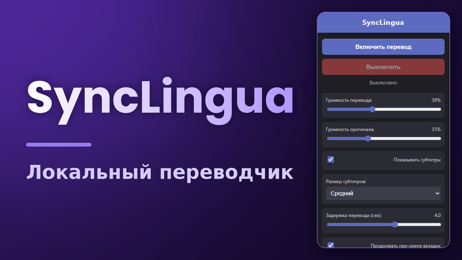
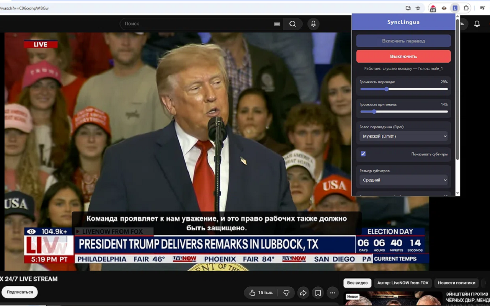
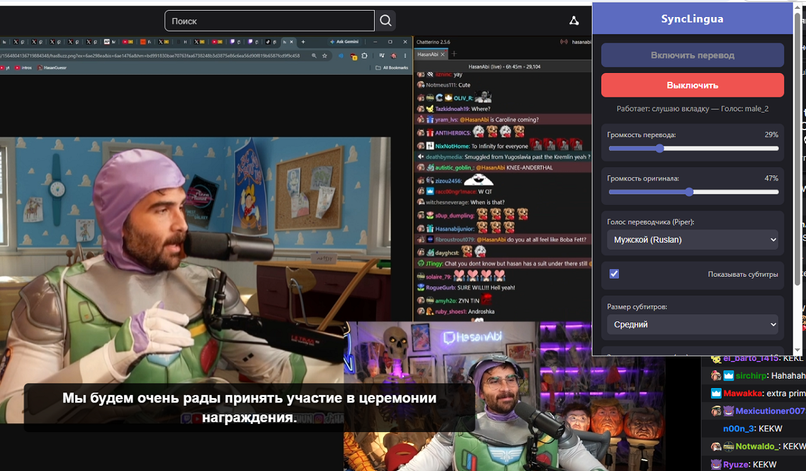
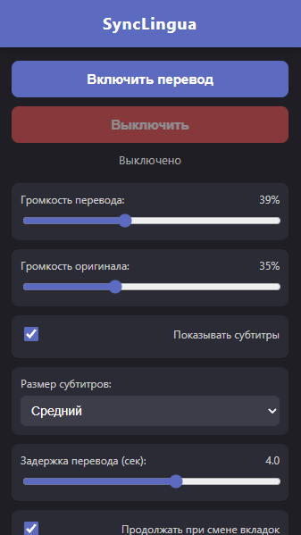

# 🎙️ SyncLingua Translator



**Синхронный перевод звука вкладки с озвучкой и субтитрами. 100% локально и бесплатно.**

[](#)
[](#)
[](#)

SyncLingua — это расширение для Chrome и локальный сервер, которые переводят английскую речь в видео на русский язык в реальном времени. 
В отличие от облачных сервисов, **ваш звук не покидает ваш компьютер**. Распознавание, перевод и синтез речи происходят локально на вашем ПК.

## ✨ Основные возможности
*   **Синхронный перевод:** EN → RU в реальном времени.
*   **Локальность:** Полная приватность, никаких подписок и отправки данных на сторонние серверы.
*   **Озвучка:** 4 качественных голоса на выбор (3 мужских, 1 женский).
*   **Субтитры:** Отображение текста поверх видео с настройкой размера.
*   **Умное приглушение:** Оригинальный звук автоматически затихает, когда говорит переводчик (Ducking).
*   **Гибкость:** Настройка громкости перевода и оригинала, а также задержки перевода.

## 📸 Скриншоты



---

## 🚀 Установка и запуск (Для пользователей)

### Шаг 1: Установите Ollama и модель
1. Скачайте и установите [Ollama](https://ollama.com/download).
2. Откройте командную строку (`cmd`) и выполните:
   ```cmd
   ollama pull translategemma:4b
   ```
   *(Дождитесь окончания загрузки, модель весит около 3.3 ГБ).*

### Шаг 2: Запустите локальный сервер
1. Перейдите в раздел [Releases](https://github.com/dimonyasha/synclingua-translator/releases) на этой странице.
2. Скачайте архив `SyncLingua-Public.zip` и распакуйте его в удобную папку.
3. Запустите `SyncLingua-Server.exe` (желательно от имени администратора).
4. Дождитесь появления в консоли строки `Uvicorn running on http://127.0.0.1:8000`. **Окно не закрывайте.**

### Шаг 3: Установите расширение в Chrome
Так как расширение пока не опубликовано в официальном магазине, установим его через «Режим разработчика»:
1. В папке `SyncLingua-Public` найдите папку `chrome-translator`.
2. Откройте браузер Chrome и перейдите по адресу `chrome://extensions/`.
3. Включите **«Режим разработчика»** (тумблер в правом верхнем углу).
4. Нажмите кнопку **«Загрузить распакованное расширение»** (в левом верхнем углу).
5. Выберите папку `chrome-translator`.
6. Расширение установлено! Закрепите иконку SyncLingua на панели Chrome.

### Шаг 4: Использование
1. Откройте видео на YouTube или Twitch.
2. Нажмите на иконку SyncLingua и нажмите «Включить перевод».
3. Наслаждайтесь русской озвучкой и субтитрами!

*(Если субтитры не появились сразу — обновите страницу с видео (F5)).*

---

## 🛠️ Технологический стек
*   **Server:** Python 3.11, FastAPI, WebSockets
*   **ASR:** Faster-Whisper (локально)
*   **Translation:** Ollama (translategemma:4b)
*   **TTS:** Piper TTS (локально)
*   **Client:** Chrome Extension (Manifest V3), Web Audio API

## 💖 Поддержать проект
SyncLingua — это полностью бесплатный и открытый проект. Я не беру денег за подписку, не показываю рекламу и не собираю ваши данные. Всё работает локально на вашем компьютере.

Если проект сэкономил вам время, вы можете поддержать дальнейшую разработку. Собранные средства пойдут на:
*   Покупку аккаунта разработчика Google для публикации в Chrome Web Store (цель: ~5000 руб.).
*   Улучшение качества голосов и добавление новых языков.

[](https://boosty.to/dimonyasha)

## 📄 Лицензия
Проект распространяется под лицензией MIT.
