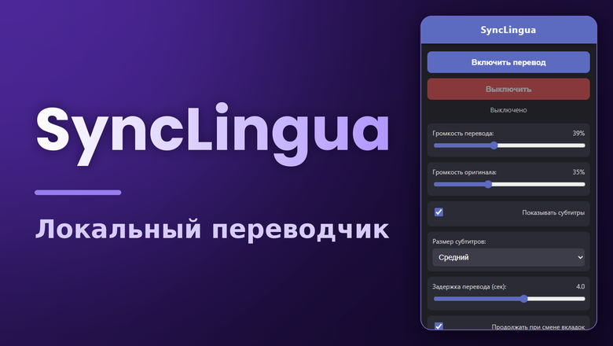
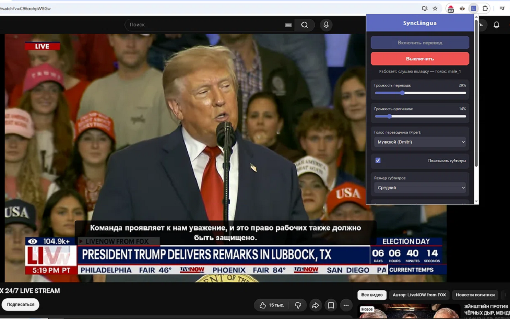
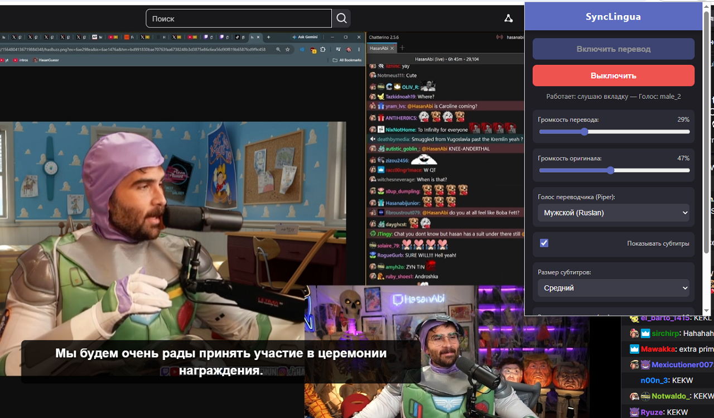
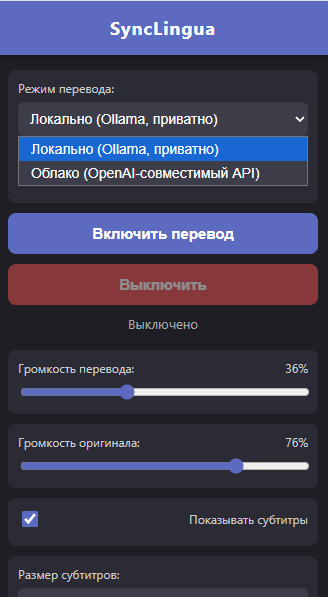

# 🎙️ SyncLingua Translator

<p align="center">
  <a href="https://github.com/dimonyasha/synclingua-translator/releases">
    
  </a>
</p>

**Синхронный перевод звука вкладки с озвучкой и субтитрами. Приватно, локально и бесплатно.**

[](#)
[](#)
[](#)

SyncLingua — это расширение для браузера и локальный сервер, которые переводят английскую речь в видео на русский язык в реальном времени. 

В отличие от облачных сервисов, **по умолчанию ваш звук не покидает компьютер**. Однако, если ваш ПК слабый, вы можете переключиться на облачный перевод (в сеть уйдет только текст).

## ✨ Основные возможности
*   **Гибридный режим:** Выбор между 100% локальным переводом (Ollama) и облачным API (GigaChat, OpenRouter).
*   **Синхронный перевод:** EN → RU в реальном времени.
*   **Озвучка:** 4 качественных голоса на выбор (3 мужских, 1 женский).
*   **Субтитры:** Отображение текста поверх видео с настройкой размера.
*   **Режим «Только субтитры»:** Отключает озвучку для экономии ресурсов процессора.
*   **Умное приглушение:** Оригинальный звук автоматически затихает, когда говорит переводчик (Ducking).
*   **Гибкость:** Настройка громкости перевода и оригинала, а также задержки перевода.

## 📸 Скриншоты



---

## 🚀 Установка и запуск (Для пользователей)

### Шаг 1: (Опционально) Установите Ollama
*Только для локального режима. Если вы планируете использовать облачный режим (GigaChat), этот шаг можно пропустить.*
1. Скачайте и установите [Ollama](https://ollama.com/download).
2. Откройте командную строку (`cmd`) и выполните:
   ```cmd
   ollama pull translategemma:4b
(Дождитесь окончания загрузки, модель весит около 3.3 ГБ).

Шаг 2: Установите SyncLingua
Перейдите в раздел Releases на этой странице.

Скачайте файл SyncLingua_Setup.exe и запустите его.

Следуйте инструкциям установщика. На рабочем столе появится ярлык «SyncLingua Server». Запустите его.

Дождитесь появления в консоли строки Uvicorn running on http://127.0.0.1:8000. Окно не закрывайте.

Шаг 3: Установите расширение в браузер
Так как расширение пока не опубликовано в официальном магазине, установим его через «Режим разработчика»:

Откройте браузер и перейдите по адресу chrome://extensions/ (или browser://extensions/ для Яндекс.Браузера).

Включите «Режим разработчика» (тумблер в правом верхнем углу).

Нажмите кнопку «Загрузить распакованное расширение».

Перейдите в папку, куда установилась программа (по умолчанию: C:\Program Files\SyncLingua\chrome-translator), и выберите её.

Расширение установлено! Закрепите иконку SyncLingua на панели.

Шаг 4: Использование
Откройте видео на YouTube, Twitch или другом сайте.

Нажмите на иконку SyncLingua и нажмите «Включить перевод».

Наслаждайтесь русской озвучкой и субтитрами!

(Если субтитры не появились сразу — обновите страницу с видео (F5)).

🌐 Гибридный режим (Локально / Облако)
В настройках расширения вы можете выбрать один из режимов:

Локально (Ollama) — 100% приватно, работает без интернета (после скачивания моделей).

Облако (OpenAI-совместимый API) — быстро, не грузит ваш ПК. Отлично подходит для слабых ноутбуков.

Только субтитры — отключает озвучку, оставляя только текст (самый легкий режим).

В облачном режиме звук по-прежнему распознается локально (Whisper), а в сеть уходит только распознанный текст!

Как настроить облако (на примере GigaChat от Сбера):
Зайдите на developers.sber.ru, создайте проект GigaChat API (выберите физлицо, чтобы получить бесплатный лимит токенов).

Скопируйте Ключ авторизации (Authorization key, длинная строка Base64).

В настройках расширения выберите режим «Облако».

Заполните поля:

URL API: https://api.giga.chat/v1

API Ключ: ваш Ключ авторизации

Модель: GigaChat-3-Ultra

Важно: Оставьте галочку «Проверять SSL-сертификат» включенной. Начиная с версии 1.1.2 SyncLingua автоматически подхватывает сертификаты Минцифры из установщика! (Снимать галочку нужно только в крайнем случае, если возникла ошибка соединения).

(Также вы можете использовать OpenRouter, Groq или любой другой OpenAI-совместимый сервис).

🛠️ Технологический стек
Server: Python 3.11, FastAPI, WebSockets

ASR: Faster-Whisper (локально)

Translation: Ollama (translategemma:4b) или Cloud API

TTS: Piper TTS (локально)

Client: Chrome Extension (Manifest V3), Web Audio API

💖 Поддержать проект
SyncLingua — это полностью бесплатный и открытый проект. Я не беру денег за подписку, не показываю рекламу и не собираю ваши данные. Всё работает локально на вашем компьютере.

Если проект сэкономил вам время, вы можете поддержать дальнейшую разработку. Собранные средства пойдут на:

Оплату хостинга и домена, чтобы у проекта появился свой официальный сайт.

Улучшение качества голосов и добавление новых языков.

Разработку новых функций (например, переводчика текста с экрана).

https://img.shields.io/badge/%D0%9F%D0%BE%D0%B4%D0%B4%D0%B5%D1%80%D0%B6%D0%B0%D1%82%D1%8C-Boosty-orange?style=for-the-badge&logo=heart&logoColor=white

📄 Лицензия
Проект распространяется под лицензией MIT.
